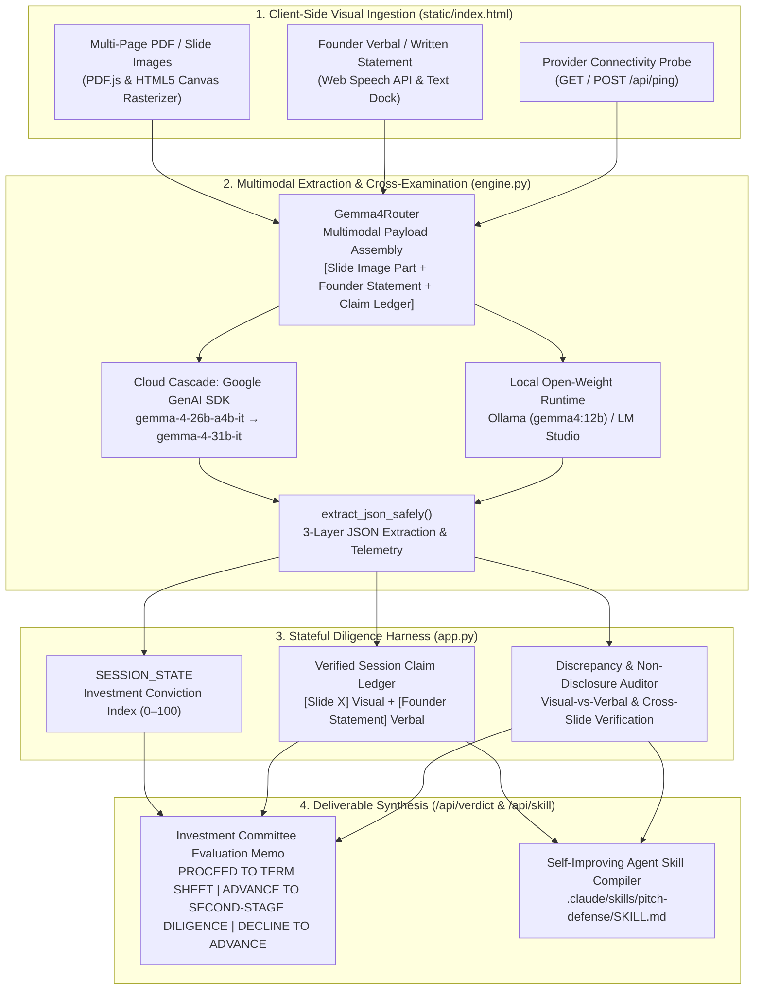

<a href="https://www.ojasdeshpande.in" target="_blank"></a>


# HotSeat AI

*Institutional Venture Capital Diligence, Multimodal Thesis Verification & Self-Improving Agent Skill Compiler powered by Gemma 4.*

[-2563eb?style=for-the-badge)](https://ai.google.dev/gemma)
[](https://ai.google.dev/gemini-api/docs)
[](./graphify-out/GRAPH_REPORT.md)
[-4f46e5?style=for-the-badge)](./.claude/skills/pitch-defense/SKILL.md)
[](./LICENSE)

---

## Executive Overview & Problem Statement

### The Problem
Early-stage founders and enterprise presenters frequently harbor structural blind spots across their presentation materials. In institutional due diligence, investment committees routinely uncover unit economics that contradict go-to-market slides, undocumented channel distribution and fulfillment costs, regulatory pathway misclassifications, or verbal representations that directly conflict with the visual financial charts on screen. Traditional static pitch-deck reviewers evaluate text in isolation without cross-examining visual slide artifacts against cumulative verbal claims.

### The Solution
**HotSeat AI** is an institutional venture diligence and multimodal thesis verification engine. Operating as a specialized **Managing Partner**, **Chief Financial Officer**, **Enterprise Procurement Lead**, or **Technical Diligence Partner**, the platform:
1. **Inspects presentation slides directly via Gemma 4 Multimodal Vision**, extracting quantitative metrics, financial schedules, and strategic assertions from slide pixels.
2. **Maintains a stateful Session Claim Ledger**, indexing every visual slide assertion alongside every verbal or written founder statement.
3. **Detects visual-vs-verbal and cross-slide discrepancies in real time**, flagging conflicts between the slide currently displayed on screen, the founder's active response, and representations made on prior slides.
4. **Synthesizes institutional deliverables**, compiling a quantitative **Investment Committee (IC) Evaluation Memo** and dynamically updating a portable, spec-compliant **Agent Skill (`.claude/skills/pitch-defense/SKILL.md`)**.

---

## System Architecture

### 4-Stage Cognitive Diligence Pipeline



### Architectural Component Breakdown

| Stage | Module | Primary Responsibility | Key Technical Primitives |
| :--- | :--- | :--- | :--- |
| **1. Client-Side Visual Ingestion** | `static/index.html` | Rasterizes multi-page PDFs and high-resolution slide images into `1280px` compressed JPEG frames in browser memory; captures voice dictation and manages real-time provider telemetry. | `PDF.js v3.11`, HTML5 `<canvas>`, `SpeechRecognition`, `SpeechSynthesis` |
| **2. Multimodal Extraction & Cross-Examination** | `engine.py` | Assembles multimodal contents (`[types.Part.from_bytes(...), prompt]`), routes inference to Gemma 4 via Google GenAI SDK or local open-weight runtimes, strips `<thought>` blocks, and measures exact round-trip latency (`ms`). | `google-genai` SDK, `Gemma4Router`, `extract_json_safely()`, `/api/ping` |
| **3. Stateful Diligence Harness** | `app.py` | Maintains `SESSION_STATE`, updates the **Investment Conviction Index (`0–100`)**, appends visual and verbal claims to `claim_ledger`, and audits visual-vs-verbal consistency. | FastAPI, `POST /api/interrogate`, `GET /api/state`, `POST /api/reset` |
| **4. Deliverable Synthesis** | `app.py` & `.claude/skills/` | Generates the structured **IC Evaluation Memo** across 4 analytical rubric dimensions and compiles discovered discrepancies and guardrails into `.claude/skills/pitch-defense/SKILL.md`. | `POST /api/verdict`, `GET / POST /api/skill`, `_compile_skill_md()` |

---

## Key Institutional Features

- **Zero Domain Hardcoding (Industry-Agnostic):** Dynamically classifies the startup's sector and business model strictly from the active slide pixels and founder transcript—supporting FinTech, Healthcare/MedTech, D2C Retail, DeepTech, B2B Enterprise SaaS, Climate, and Hardware without pre-seeded assumptions.
- **Visual-vs-Verbal Discrepancy Detection:** Cross-checks what is visually displayed on the presentation slide against what the founder states verbally and what was represented on earlier slides in the `Verified Session Claim Ledger`. If a founder presents a Healthcare/Clinical Diagnostics slide while claiming to operate a B2B finance business—or presents a Slide 2 budget that contradicts Slide 1 acquisition metrics—the engine immediately raises a `MATERIAL DISCREPANCY IDENTIFIED` flag and adjusts conviction.
- **4 Specialized Diligence Roles:**
  - *Managing Partner (Venture & Growth)* — Evaluates thesis consistency, TAM/SAM/SOM methodology, distribution velocity, and structural defensibility.
  - *Chief Financial Officer (Unit Economics & Audit)* — Audits CAC payback, gross and contribution margin bridges, burn multiples, and working capital cycles.
  - *Enterprise Procurement Lead (Security & ROI)* — Probes regulatory compliance, deployment friction, switching costs, and auditable customer ROI.
  - *Technical Diligence Partner (Architecture & Defensibility)* — Examines system architecture, clinical/engineering validation cohorts, and unit compute/production costs.
- **Built-In Multi-Industry Benchmark Decks:** Includes 3 instant 3-slide benchmark decks (**FinTech Deck**, **Healthcare Deck**, **D2C Retail Deck**) rendered directly on `#slideCanvas` with intentional cross-slide financial and operational discrepancies for immediate verification, alongside custom `.pdf`, `.png`, `.jpg`, and `.webp` upload support.
- **Live Provider Telemetry & Diagnostics:** Probes connection health and round-trip latency (`ms`) across **Google Gemini API (`gemma-4-26b-a4b-it`)**, **Local Ollama (`gemma4:12b`)**, and **LM Studio (`gemma-4-12b-it`)**, displaying real-time model and latency telemetry in the institutional header bar.

---

## Hackathon Track & Sponsor Compliance Disclosures

| Track / Requirement | Implementation & Verification Artifact | Status |
| :--- | :--- | :--- |
| **Best Use of Gemma 4 (Gemini API)** | [`engine.py`](./engine.py) (`Gemma4Router._cloud_cascade`) calls `client.models.generate_content(model="gemma-4-26b-a4b-it", contents=[image_part, prompt])` via `from google import genai` with cascade support to `gemma-4-31b-it` and live millisecond latency telemetry in `#telemetryBadge`. | Verified |
| **Open-Source / Open-Weight AI** | Licensed under [`Apache-2.0`](./LICENSE); compliant with [Google Gemma Terms of Use](https://ai.google.dev/gemma/terms). Supports 100% local open-weight execution via Ollama (`OLLAMA_MODEL="gemma4:12b"`) and LM Studio without cloud fallback. | Verified |
| **Agent Skills Open Standard (`SKILL.md`)** | [`.claude/skills/pitch-defense/SKILL.md`](./.claude/skills/pitch-defense/SKILL.md) is dynamically compiled and persisted on every diligence turn via `_persist_skill_md()` in [`app.py`](./app.py) and exportable from the UI. | Verified |
| **Sponsor Integration: Graphify AST Knowledge Graph** | Committed AST knowledge graph artifacts in [`graphify-out/`](./graphify-out/): [`GRAPH_REPORT.md`](./graphify-out/GRAPH_REPORT.md), [`graph.json`](./graphify-out/graph.json), and [`graph.html`](./graphify-out/graph.html), plus project skill [`.claude/skills/graphify/SKILL.md`](./.claude/skills/graphify/SKILL.md). | Verified |

### 1. Track: Best Use of Gemma 4 (via Gemini API)
In [`engine.py`](./engine.py), `Gemma4Router` uses the official Google GenAI SDK (`google-genai>=1.0.0`) with Gemma 4's required multimodal part ordering (image bytes placed before text prompt):

```python
import time
from google import genai
from google.genai import types

client = genai.Client(api_key=active_api_key)
start_t = time.time()
contents = []
if image_bytes:
    contents.append(types.Part.from_bytes(data=image_bytes, mime_type=mime_type))
contents.append(prompt)

response = client.models.generate_content(
    model=model_id,  # Default: "gemma-4-26b-a4b-it", cascade to "gemma-4-31b-it"
    contents=contents,
    config=types.GenerateContentConfig(
        temperature=0.3,
    ),
)
latency_ms = int((time.time() - start_t) * 1000)
```

### 2. Track: Open-Source / Open-Weight AI & Agent Skills
- **Repository License:** [`LICENSE`](./LICENSE) (`Apache-2.0`)
- **Gemma Open-Weight Terms:** [Google Gemma Terms of Use](https://ai.google.dev/gemma/terms)
- **Local Open-Weight Execution:** `Gemma4Router` in [`engine.py`](./engine.py) supports direct local execution against **Ollama** (`http://127.0.0.1:11434/api/chat`, default `OLLAMA_MODEL="gemma4:12b"`) and **LM Studio** (`http://127.0.0.1:1234/v1/chat/completions`).
- **Self-Improving Agent Skill Compiler:** Inspired by the Hermes self-improving agent loop and the Agent Skills Open Standard, every diligence turn synthesizes a reusable audit rule (`new_skill_guardrail`) and logs any discovered cross-slide contradictions into [`.claude/skills/pitch-defense/SKILL.md`](./.claude/skills/pitch-defense/SKILL.md).

### 3. Compulsory Sponsor Integration — Graphify Knowledge Graph
The codebase is indexed and analyzed using **Graphify** (`graphifyy>=0.9.38`). Committed artifacts for judge inspection:
- **[`graphify-out/GRAPH_REPORT.md`](./graphify-out/GRAPH_REPORT.md):** Deterministic AST structural analysis, God Nodes (`Gemma4Router`, `extract_json_safely()`, `interrogate()`, `verdict()`), and community clustering.
- **[`graphify-out/graph.json`](./graphify-out/graph.json):** Complete NetworkX AST knowledge graph serialization.
- **[`graphify-out/graph.html`](./graphify-out/graph.html):** Interactive browser-based force-directed graph visualization.

---

## Quickstart & Local Setup Instructions

### 1. Clone the Repository & Create a Virtual Environment
```bash
git clone https://github.com/Ojas-Deshpande/HotSeatAI-HackDay-2026-GDG_VU.git
cd HotSeatAI-HackDay-2026-GDG_VU
python3 -m venv .venv
source .venv/bin/activate
```

### 2. Install Dependencies
```bash
pip install --upgrade pip
pip install -r requirements.txt
```

### 3. Configure Environment Variables (`.env`)
Copy `.env.example` to `.env` and provide your Google AI Studio `GEMINI_API_KEY` (and optional local Ollama / LM Studio settings):
```bash
cp .env.example .env
```

Key variables in `.env`:
```ini
GEMINI_API_KEY="your_google_ai_studio_api_key"
GEMMA_MODEL_ID="gemma-4-26b-a4b-it"
GEMMA_FALLBACK_MODELS="gemma-4-26b-a4b-it,gemma-4-31b-it"
OLLAMA_URL="http://127.0.0.1:11434/api/chat"
OLLAMA_MODEL="gemma4:12b"
LMSTUDIO_URL="http://127.0.0.1:1234/v1/chat/completions"
LMSTUDIO_MODEL="gemma-4-12b-it"
```

### 4. Start the FastAPI Diligence Server
```bash
uvicorn app:app --reload --host 0.0.0.0 --port 8000
```
Open **http://127.0.0.1:8000** in your browser.

### 5. Update the Graphify Repository Knowledge Graph
```bash
python -m graphify update .
GRAPHIFY_BACKEND=none graphify cluster-only .
```

---

## 60-Second Judge Verification Guide

1. **Select a Benchmark Deck or Upload a Custom Slide:**
   Open **http://127.0.0.1:8000**, verify live Gemma 4 connectivity and millisecond latency in the top header bar, and click **Healthcare Deck** (or upload any custom `.pdf`, `.png`, or `.jpg` deck).
2. **Execute Multimodal Visual Extraction:**
   Click **Present Current Slide to Partner**. Observe Gemma 4 Vision inspect the slide pixels, classify the sector (`Healthcare & Clinical Diagnostics`) and business model, extract the exact quantitative claims into the **Visual Document Extraction Panel**, and pose a formal partner inquiry.
3. **Trigger Live Visual-vs-Verbal or Cross-Slide Discrepancy Detection:**
   - *Visual-vs-Verbal Test:* While the Healthcare slide is displayed on screen, type a conflicting statement in the Founder Input Dock (e.g., `"We are a B2B commercial lending finance company"`) and click **Submit Response**.
   - *Cross-Slide Test:* Alternatively, click **Next Slide** to advance to **Slide 2** (which reveals the product is Research Use Only with `n = 110` retrospective samples despite Slide 1 claiming FDA Class III clearance across 42 live hospital networks) and click **Present Current Slide to Partner**.
   - Observe the formal crimson **`MATERIAL DISCREPANCY IDENTIFIED`** alert box, the increment in **Unresolved Flags**, and the downward adjustment in the **Investment Conviction Index**.
4. **Synthesize the IC Evaluation Memo & Export `SKILL.md`:**
   In the right-hand column, click **Generate IC Evaluation Memo** under the **IC Evaluation Memo** tab to produce the formal committee decision (`PROCEED TO TERM SHEET`, `ADVANCE TO SECOND-STAGE DILIGENCE`, or `DECLINE TO ADVANCE`) and analytical rubric scores. Switch to the **SKILL.md Guardrails** tab and click **Export SKILL.md** to download the self-improved `.claude/skills/pitch-defense/SKILL.md` specification.

---


## Author

Ojas Deshpande [contact@ojasdeshpande.in]